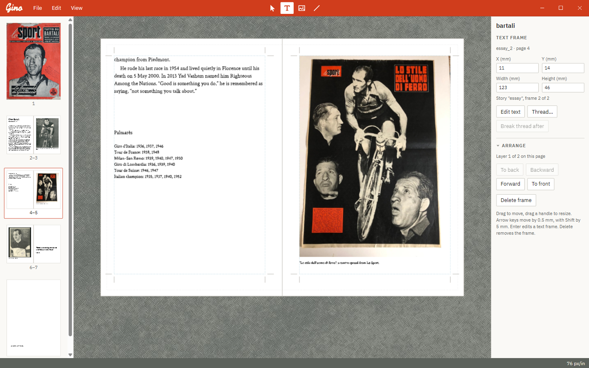
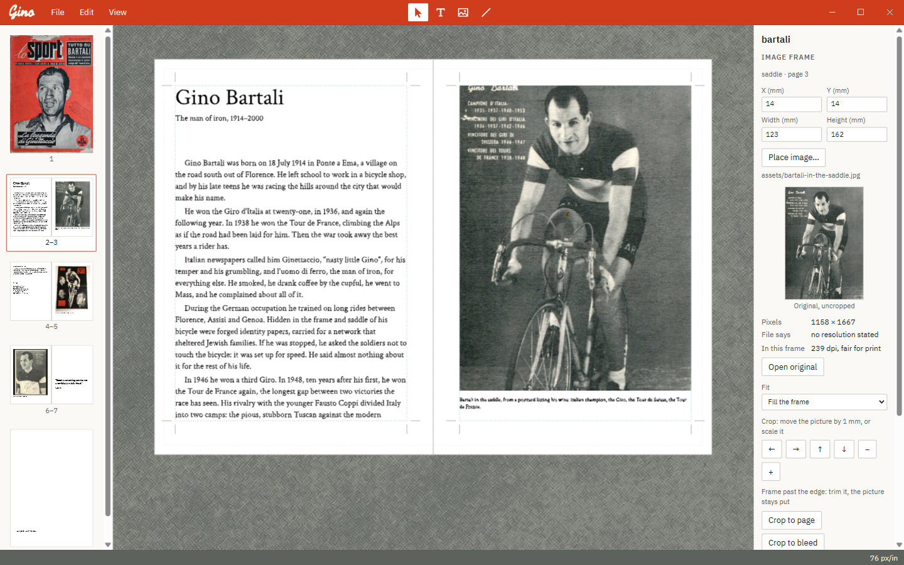
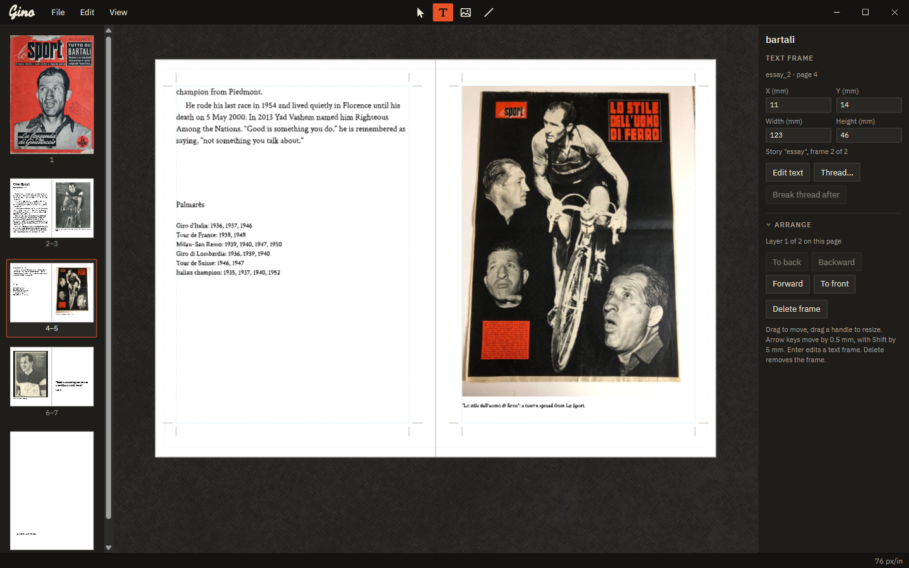

# Gino

A small, free, offline Windows program for laying out zines. Place text and images on pages, see them as spreads, and print pages that fold into a booklet on the first try.

| Lo Sport (light) | Uomo di ferro (dark) |
| --- | --- |
|  |  |

*An eight-page zine about the cyclist Gino Bartali, laid out in both colour schemes.*

## Download and install

1. Go to the [latest release](https://github.com/gmleuning/gino/releases/latest) and download **`Gino_…_x64-setup.exe`**.
2. Run it. Gino installs for your Windows account only, so no administrator rights are needed. Windows may say the installer is from an unknown publisher: choose **More info**, then **Run anyway**.
3. Start Gino from the Start menu or the desktop shortcut.

Gino needs Windows 10 or 11 (64-bit). It uses the Edge WebView2 runtime that comes with current Windows; on an older Windows 10 the installer fetches it if it is missing. Everything works offline.

**To update**, run the newer installer; it replaces the old version and keeps your preferences. **To uninstall**, use Windows Settings → Apps → Gino. Your zines are never touched.

## First zine in five minutes

1. **File → New**, pick a fold (A5 pages on A4 is the usual one) and a place to save. Gino makes a `.zine` folder there.
2. New zines start with a picture frame on each cover and one story running through the inside pages. Select a picture frame and press **Place image…**.
3. Double-click a text frame, or press Enter, to type. Text that does not fit is marked at the end of the frame; click the marker, then another text frame, to continue the story there.
4. **File → Print** and choose *Folded*. Print double-sided, flipping on the short edge, fold the stack in half and staple it.

Tools: **V** select, **T** text, **I** image, **L** line. Every shortcut can be changed in **Edit → Preferences → Shortcut keys**.

## What it does

- **Starts from a fold.** A5 pages on A4, A6 pages on A5, the eight-page single-sheet fold, a custom page size, or a North American saddle stitch (Letter, Legal or Tabloid pages). Margins, gutter and sheet follow from the choice, and you can change them in the document panel.
- **Frames.** Text, image and line frames in millimetres, snapping to margins, columns, the spine and each other. Drag to move, drag a handle to resize, arrow keys nudge (Shift for 5 mm), Delete removes.
- **Bilingual text.** Korean and English set together, with Korean input-method support on the canvas. Paragraph styles pick a Latin font, a Korean font and whether Korean breaks between syllables or only at spaces. The Korean controls stay hidden until you turn them on in Preferences.
- **Threaded text.** A story flows from frame to frame and across pages.
- **Images.** PNG, JPEG and TIFF, linked by path. The panel shows the whole original, its pixel size and the resolution it prints at. Fill, fit or manual crop; **Crop to page** and **Crop to bleed** trim a frame that runs off the edge.
- **Guides, off by default.** Margins and columns, bleed, frame outlines and crop marks can each be shown or hidden. The page always stays white, as it will print.
- **Print.** *Paged* (every page alone), *Viewed* (spreads as on screen) or *Folded* (imposed sheets in fold order), each at a resolution you choose. Fonts are embedded in every PDF.
- **Undo and redo** for every change.
- **Two colour schemes.** *Lo Sport* (light) and *Uomo di ferro* (dark), or follow Windows.
- **Your own desk.** **Edit → Preferences → Desk behind the pages → Choose picture…** puts any JPEG, PNG or TIFF behind the pages; **Use Gino's own** brings the printed grey back.

Not done yet: JPG and PNG export, hyphenation, page-number master page, photocopy preview.

## Fonts

Gino comes with two fonts, used for new zines unless you pick others: Crimson Text and Gowun Dodum, both under the SIL Open Font License. Any font installed in Windows can be used too.

## Your files

A zine is a folder ending in `.zine`. It holds a readable `document.json` (settings, styles, stories, pages, frames) and an `assets` folder. Lengths are in millimetres, type in points, and image paths are relative to the folder, so a `.zine` folder can be copied or zipped and opened anywhere.

Preferences are kept in `%APPDATA%\app.ginos\preferences.json`.

## Building from source

See [BUILDING.md](BUILDING.md).

Built on [Tauri](https://v2.tauri.app/), [Parley](https://github.com/linebender/parley), [krilla](https://github.com/LaurenzV/krilla), [resvg](https://github.com/linebender/resvg) and [image](https://github.com/image-rs/image). Each keeps its own licence.

Ⓐ
